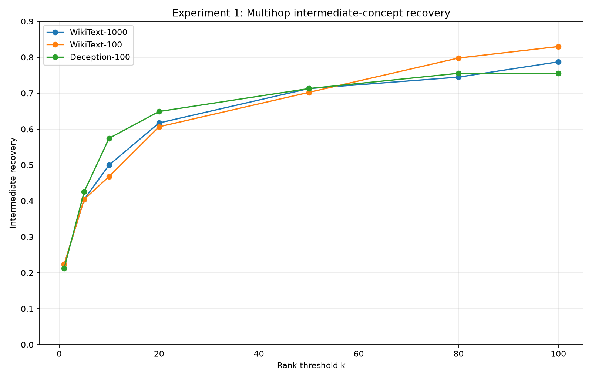
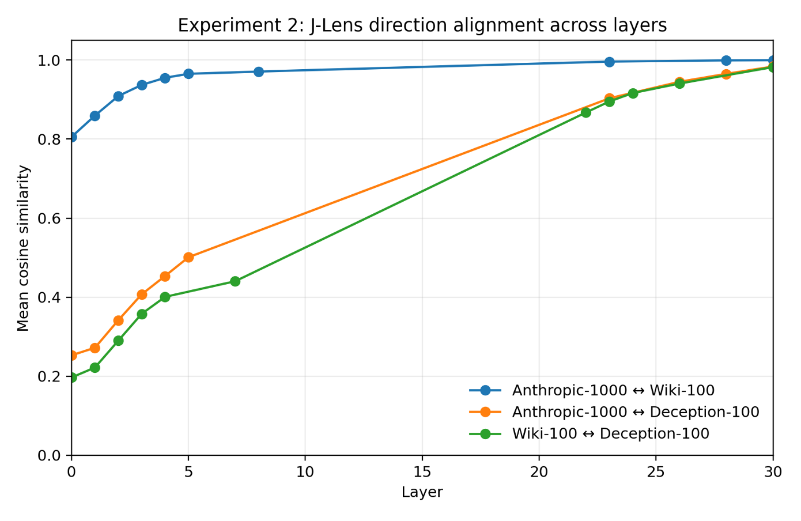
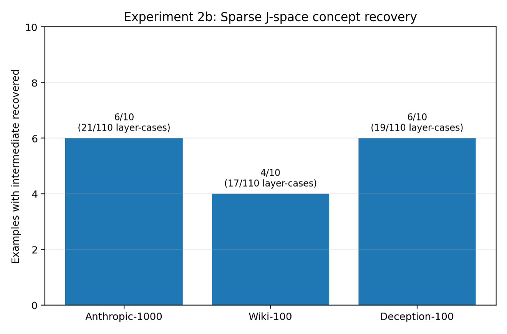

# JLens-Probe

**How sensitive are Jacobian Lens representations to the distribution used to fit the lens?**

This project compares Jacobian lenses fitted on WikiText and deception-oriented data for Qwen3.5-4B. The goal is to test whether changing the fitting distribution changes the concepts exposed by the lens while keeping the underlying language model fixed.

The repository compares three lenses:

- **WikiText-1000** — a public J-Lens checkpoint fitted on 1,000 WikiText examples and distributed through `neuronpedia/jacobian-lens`.
- **WikiText-100** — a locally fitted lens using 100 WikiText examples.
- **Deception-100** — a locally fitted lens using 100 deception-oriented examples.

WikiText-1000 vs. WikiText-100 provides a same-distribution, different-sample-size baseline. WikiText-100 vs. Deception-100 compares fitting distributions at matched sample count.

## Experiments

### 1. Intermediate concept recovery

`experiment_1_intermediate_recovery.py` tests whether each lens recovers known intermediate concepts in the upstream multihop evaluation set. For each example, it measures the vocabulary rank of the intermediate token across fitted layers and reports `pass@k`.

In the committed results, all three lenses recover a substantial fraction of the same intermediate concepts. For example, `pass@20` is about 0.62 for WikiText-1000 and WikiText-100, and 0.65 for Deception-100.



### 2. Vocabulary-linked direction alignment

`experiment_2_direction_alignment.py` compares token-linked J-Lens directions across the three lenses using cosine similarity. For token `v` and layer `l`, the direction is

```text
d_(v,l) = J_l^T w_v
```

where `w_v` is the model's unembedding vector for token `v`.

The WikiText-100 lens is already fairly aligned with WikiText-1000 at layer 0 and becomes very closely aligned in later layers. The Deception-100 lens differs more strongly in early and middle layers before converging toward the other lenses in later layers.



### 2b. Sparse concept recovery

`experiment_2b_sparse_concepts.py` asks whether different fitted lenses select the same sparse token concepts for the **same residual activation**. It constructs token-indexed directions `J_l^T w_v` and greedily reconstructs the residual with a non-negative sparse combination of `K=25` directions.

The exact gradient-pursuit implementation used in the reference work is not public. This script uses a full-vocabulary non-negative greedy pursuit with projected-gradient refitting and should be treated as an approximate implementation rather than an exact reproduction of the unpublished sparse-decomposition algorithm.



### 3. Safety-relevant readout *(in progress)*

`experiment_3_safety_readout.py` compares the three lenses on available alignment-audit prompts using two readouts: deception-related tokens in the J-Lens top-k predictions and an evaluation-awareness score based on configured token sets. Experiment 3 results are not included in the current repository.

## Deception fitting corpus

`build_deception_DeceptionBench.py` generates candidate responses from `PKU-Alignment/DeceptionBench` using Qwen3.5-4B. Generation uses fixed-seed sampling and is saved incrementally so longer runs can be resumed.

The exact 100-example deception fitting corpus used by this project is committed at:

```text
data/deception_prompts_100_jlens.json
```

The current generation script does not fully automate the final selection/construction of these 100 examples: `build_deception_prompts()` is still a placeholder. The committed JSON file should therefore be treated as the exact fitting corpus for the reported Deception-100 lens.

## Repository structure

```text
JLens-Probe/
├── README.md
├── LICENSE
├── requirements.txt
├── config.py
├── utils.py
├── upstream_data.py
├── fit_lens.py
├── plot_results.py
├── build_deception_DeceptionBench.py
├── experiment_1_intermediate_recovery.py
├── experiment_2_direction_alignment.py
├── experiment_2b_sparse_concepts.py
├── experiment_3_safety_readout.py
├── data/
│   └── deception_prompts_100_jlens.json
├── Fitted-Jlens/
└── results/
```

The fitted .pt checkpoints used in the experiments are included in Fitted-Jlens/ and tracked with Git LFS. This allows the reported experiments to be run directly without refitting the lenses. The WikiText-100 and Deception-100 lenses can also be regenerated using fit_lens.py.

## Installation

Python 3.10+ is recommended. A GPU is strongly recommended for fitting and the full experiments.

```bash
python3 -m venv .venv
source .venv/bin/activate
python -m pip install --upgrade pip
pip install -r requirements.txt
```

`requirements.txt` installs the upstream `jlens` package directly from the official Anthropic Jacobian Lens repository, so a separate `jacobian-lens` clone is **not** required inside this repository.

The model and the public WikiText-1000 lens are downloaded through Hugging Face when first used. You may need to authenticate with Hugging Face if access requirements change.

## Upstream evaluation data

Experiments 1, 2b, and 3 use data from the upstream Anthropic Jacobian Lens repository. This project no longer assumes that `jacobian-lens/` exists inside `JLens-Probe`.

On first use, `upstream_data.py` downloads the upstream repository archive into:

```text
~/.cache/jlens-probe/
```

and reads the required data from that cached copy. Nothing is added to this Git repository.

If you already have an upstream checkout and prefer to reuse it, set:

```bash
export JLENS_UPSTREAM_DIR="/path/to/anthropics/jacobian-lens"
```

This override is optional; it is not required for a clean installation.

You can also change the cache location with `JLENS_PROBE_CACHE`.

## Fitting the local lenses

The experiments expect:

```text
Fitted-Jlens/qwen35_4b_wikitext_n100.pt
Fitted-Jlens/qwen35_4b_deception_n100.pt
```

To generate both from the data sources used by this repository:

```bash
python fit_lens.py --corpus both --n-prompts 100
```

Or fit them separately:

```bash
python fit_lens.py --corpus wikitext --n-prompts 100
python fit_lens.py --corpus deception --n-prompts 100
```

Fitting a J-Lens for Qwen3.5-4B is compute-intensive. If you already have the two checkpoints from an earlier run, copying them into `Fitted-Jlens/` avoids refitting.

## Running the experiments

Once the two local fitted lenses are available:

```bash
python experiment_1_intermediate_recovery.py
python experiment_2_direction_alignment.py
python experiment_2b_sparse_concepts.py
```

## Regenerating the README figures

The committed figures can be regenerated from the committed result JSON files without rerunning the GPU experiments:

```bash
python plot_results.py
```

This writes:

```text
results/experiment1.png
results/experiment2.png
results/experiment2b.png
```

## Reproducibility notes

The repository contains no hard-coded paths to the author's local machine and does not require a nested clone of `jacobian-lens`. External code, model weights, the public lens checkpoint, WikiText, DeceptionBench, and upstream evaluation data are obtained from their public sources at installation or runtime.

The two fitted 100-example lens checkpoints are not committed. Re-fitting them should use the same corpora and configuration, but exact binary equality can depend on software/hardware details. The committed result files correspond to the checkpoints used for the reported runs.

## Interpretation

This is a small robustness study, not a claim that one fitting distribution is generally better than another. The experiments currently use one model, small local fitting sets, and limited evaluation tasks. The sparse-decomposition experiment is approximate, and the deception-corpus selection step is not yet fully automated.

## License and upstream work

This repository is released under the MIT License. The Jacobian Lens implementation and upstream synthetic evaluation data are from the `anthropics/jacobian-lens` project and are released by Anthropic under Apache-2.0. Model weights, Hugging Face datasets, and downloaded checkpoints remain subject to their respective licenses and terms.
